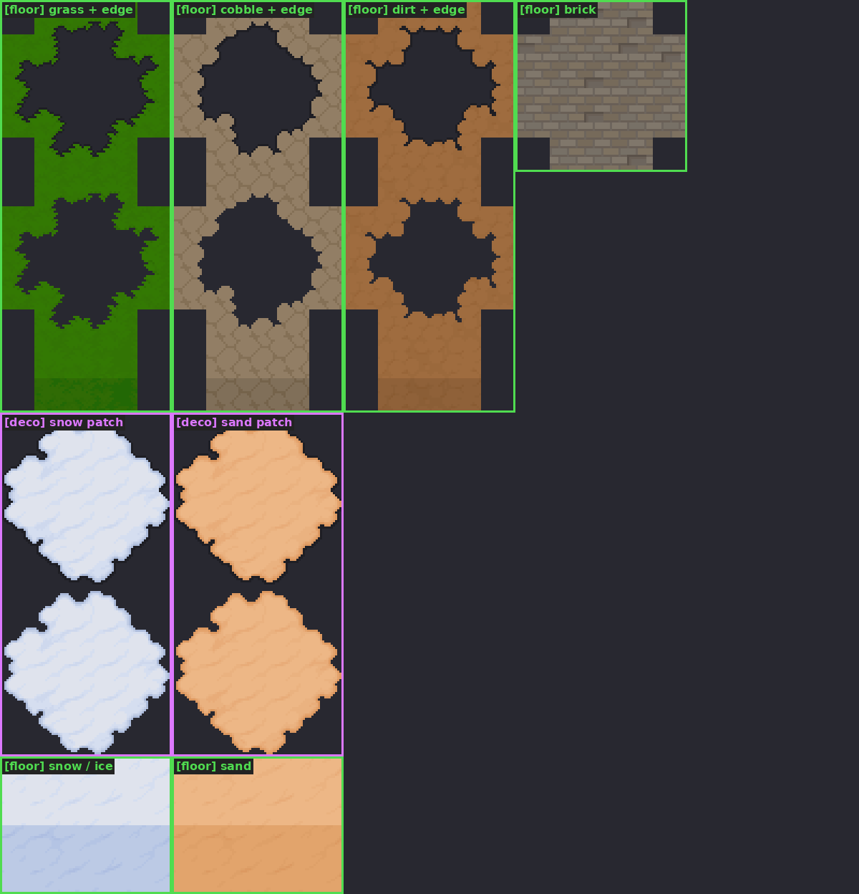
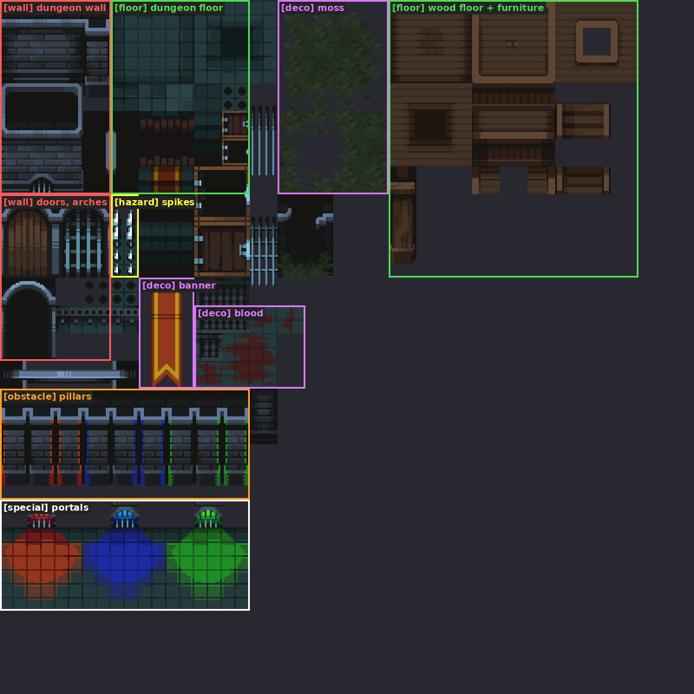
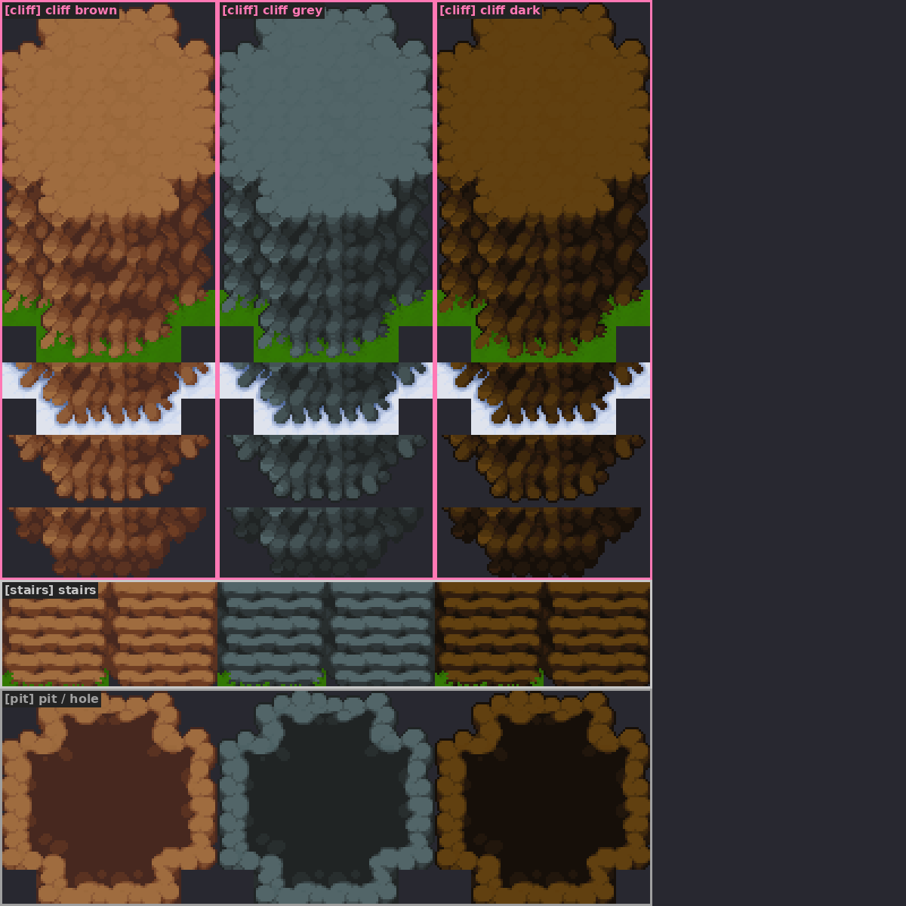
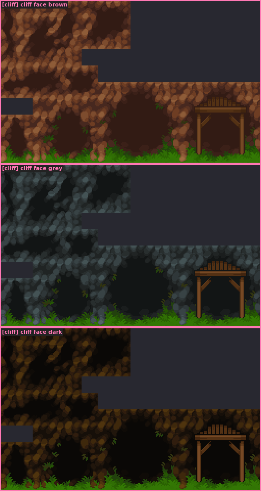
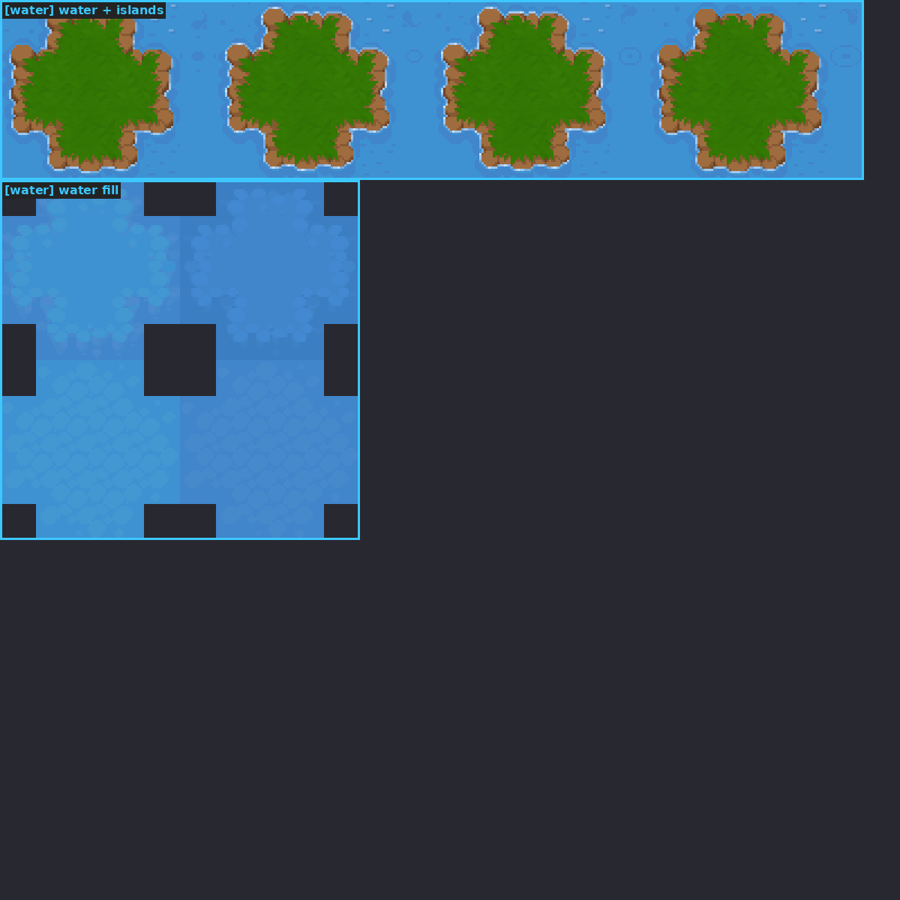

# Ground tiles — Pixel Crawler, tagged

All tiles are **16x16 px**. Sheets live in
`assets/source/third_party/pixel_crawler/Environment/Tilesets/`. Pictures below are 3x, boxes are rough
groups (a guide, not exact tile coordinates).

## Tags

| Tag | Meaning | Map generator uses it for |
|---|---|---|
| `floor` | Ground you walk on | The base layer |
| `edge` | Border of a ground type (grass → nothing) | Mixing two grounds |
| `wall` | Blocks movement, room border | Arena border |
| `cliff` | Raised ground with a side face | Natural arena border |
| `obstacle` | Blocks movement, gives cover | Random cover in the arena |
| `deco` | Drawn on top, does not block | Random detail so floors don't repeat |
| `hazard` | Hurts (spikes, pit) | Later — needs game rules first |
| `water` | Water | Later |
| `stairs`, `pit`, `special` | Stairs, holes, portals | Later |

## Sheets

| Sheet | What's in it | Tags |
|---|---|---|
| `Floors_Tiles.png` | Grass, cobblestone, dirt (each with its edge frame), brick floor, snow/sand patches + fills | `floor` `edge` `deco` |
| `Dungeon_Tiles.png` | Dark dungeon wall, doors/arches, teal dungeon floor, spikes, moss, wood floor + furniture, banner, blood, coloured pillars, portals | `wall` `floor` `hazard` `deco` `obstacle` `special` |
| `Wall_Tiles.png` | Raised cliffs in brown / grey / dark, stairs, pits | `cliff` `stairs` `pit` |
| `Wall_Variations.png` | Tall cliff faces (3 colours), one with a cave entrance | `cliff` |
| `Water_tiles.png` | Water with islands, water fills | `water` |

Plain 16 px fill tiles used by the island map (`data/maps/grass.tres`): cobble `Floors_Tiles` (6..8, 10) = rocky area;
dark grass (1..3, 11) = boss area; `Water_tiles` (1..3, 12) = water.

## Good first arena combos

- **Dungeon:** teal `floor` + dungeon `wall` + `pillars` as cover + moss/blood `deco`.
- **Outdoor:** cobble or dirt `floor` with grass `edge` + grey `cliff` border + `Rocks.png` (in
  `Environment/Props/Static/`) as cover.

## Island ground (decision 0033)

Borders use ONE straight edge window per ground (`GroundData.edge_window`, 16x16 px, ground on top, border at row 8); the 16
dual-grid pieces are built from it (see `ground_baker.gd`). Windows (px on the sheet):

| Ground | Sheet | Fills (tile coords) | Edge window |
|---|---|---|---|
| grass / boss grass | `Floors_Tiles.png` | (1..3,10) | (32,4) = ring tile above the hole, middle |
| cobble | `Floors_Tiles.png` | (6..8,10) | (112,4) |
| dirt | `Floors_Tiles.png` | (11..13,10) | (192,6) |

Not in either pack: dead/dark ground (the boss area is tinted grass), inner-corner or blob frames (built by alpha AND / OR).
